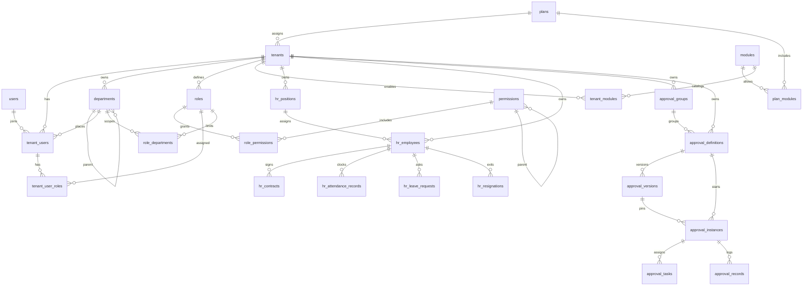

# ER

`hr_employees.department_id`、`hr_positions.department_id` 和 `hr_employees.user_id` 只存编号，图中不画外键。部门仍以 IAM 的 `departments` 为准。

`users`、`modules`、`permissions`、`plans`、`plan_modules` 是全局目录。其余业务表带 `tenant_id`。`personal_access_tokens` 的主体是 `users`，不进入上面的租户关系。
